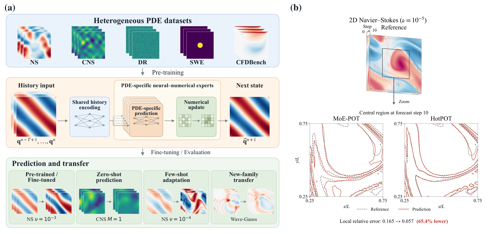

# HotPOT: Heterogeneous Physics Experts for PDE Pre-training

Code for the anonymous HotPOT submission. HotPOT combines a shared history encoder with PDE-specific neural–numerical experts for pre-training across heterogeneous PDE datasets and adaptation to downstream problems.



## Installation

Use Python 3.10+ and a CUDA-enabled PyTorch installation. Pre-training uses Linux with two GPUs.

```bash
python -m pip install -r requirements.txt
```

## Usage

### Model configurations

| Model | Shared width | Shared layers | Expert width | Expert layers | Activated scale |
| --- | ---: | ---: | ---: | ---: | ---: |
| HotPOT-17M | 256 | 2 | 512 | 5 | 17M |
| HotPOT-90M | 512 | 3 | 1024 | 7 | 90M |

Both models use 10 history frames and predict one next state. The model size denotes activated parameters; `model.parameter_ledger()` also reports total stored parameters. The 14 checkpoints behind the 24 HotPOT entries of Table 1 are released separately; [docs/CHECKPOINTS.md](docs/CHECKPOINTS.md) lists each file, its SHA-256, the test rows, the expected error and the evaluation command. The simulated-combustion experiment added during the discussion period (a 15-field reacting flow as a new family) is in [experiments/combustion](experiments/combustion/README.md).

```python
from hotpot import build_model, load_checkpoint

model = build_model(scale=17)
load_checkpoint(model, "workspace/runs/full17/checkpoint_e1000.pt")
model = model.cuda().eval()
```

See [model structure and tensor interfaces](docs/MODEL.md) for the architecture figure, inference example, physical-condition inputs, stage readouts, and numerical updates.

### Dataset protocol

Prepare the datasets using the HDF5 conventions in [MoE-POT](https://github.com/haiyangxin/MoEPOT#dataset-protocol). Each file contains a `data` array. Training uses the following six settings:

| Code identifier | Dataset |
| --- | --- |
| `ns2d_fno_1e-5` | Incompressible NS, viscosity 1e-5 |
| `ns2d_fno_1e-3` | Incompressible NS, viscosity 1e-3 |
| `ns2d_pdb_M1e-1_eta1e-2_zeta1e-2` | PDEBench compressible NS, Mach 0.1 |
| `swe_pdb` | PDEBench shallow-water equations |
| `dr_pdb` | PDEBench diffusion–reaction |
| `cfdbench` | CFDBench cavity, cylinder, and tube flows |

The [data guide](docs/DATA.md) lists the required paths, shapes, preprocessing references, and transfer datasets. After placing the data in `workspace/`, install the bundled CFDBench and Wave metadata and check the arrays:

```bash
python prepare_data.py --workspace ./workspace --check
```

### Pre-training

```bash
torchrun --standalone --nproc_per_node=2 train.py --config configs/pretrain_17m.yaml
```

Use `configs/pretrain_90m.yaml` for the larger model. The paper recipe runs for 1,000 epochs with a global batch size of 40. [Reproduction details](docs/REPRODUCING.md) cover the optimizer, sampling, checkpointing, and evaluation protocol.

### Evaluation

```bash
python evaluate.py --config configs/evaluate.yaml

# Evaluate another pre-training setting with the same checkpoint.
python evaluate.py --config configs/evaluate.yaml --task swe_pdb \
  --output ./workspace/results/full17_swe.json
```

Evaluation performs autoregressive rollout and writes aggregate and per-trajectory errors to JSON.

### Fine-tuning and transfer

```bash
# Fine-tune a pre-training task.
python finetune.py --config configs/finetune.yaml

# Evaluate under unseen coefficients without fine-tuning.
python finetune.py --config configs/zero_shot.yaml

# Adapt using 64 target trajectories.
python finetune.py --config configs/few_shot.yaml

# Transfer the history encoder to a new PDE family.
python finetune.py --config configs/wave.yaml
```

Training and test evaluation are separate commands. See [REPRODUCING.md](docs/REPRODUCING.md) for test commands, supported shot counts, and checkpoint-selection rules.

### Configuration files

YAML keys correspond to command-line options. Command-line values override the configuration. Paths are relative to the working directory; run the examples from the repository root. `--config_file` is also accepted.

```bash
# Inspect the resolved settings without loading data or starting training.
python train.py --config configs/pretrain_17m.yaml --print-config

# Shared-encoder ablation.
torchrun --standalone --nproc_per_node=2 train.py \
  --config configs/pretrain_17m.yaml --variant untied \
  --output ./workspace/runs/untied17
```

The [configuration guide](configs/README.md) lists all recipes. The [ablation guide](docs/ABLATIONS.md) explains the **shared-representation** and **numerical-expert** controls.

## Code structure

```text
train.py               distributed pre-training
evaluate.py            autoregressive evaluation
finetune.py            fine-tuning and transfer
prepare_data.py        metadata installation and data checks
configs/               runnable YAML configurations and data paths
hotpot/
  models.py            model construction and checkpoint loading
  _internal/           encoders, experts, numerical updates, data, and training
  _vendor/             attributed AFNO implementation
metadata/              CFDBench mappings and Wave split
assets/                paper figures (PNG and PDF)
docs/                  model, data, reproduction, and ablation guides
tests/                 CPU routing, checkpoint, and configuration checks
```

The package entry points (`python -m hotpot.train`, `hotpot.evaluate`, and `hotpot.transfer`) remain available with the same options. Run the CPU checks with:

```bash
python -m pip install -e '.[test]'
python -m pytest -q
```

## Acknowledgements

This implementation builds on the architecture and data conventions of [MoE-POT](https://github.com/haiyangxin/MoEPOT) and [DPOT](https://github.com/thu-ml/DPOT). Third-party attribution is retained in [THIRD_PARTY_NOTICES.md](THIRD_PARTY_NOTICES.md).
