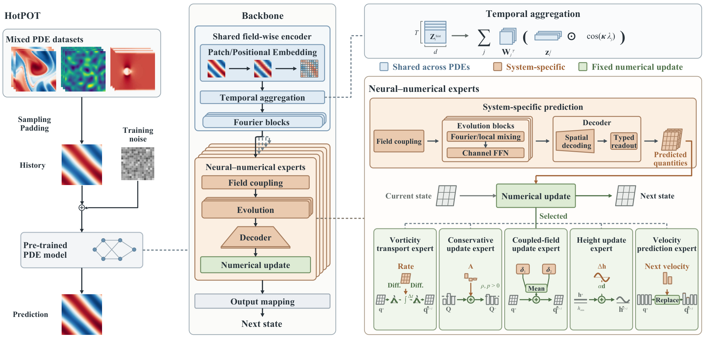

# Model structure



HotPOT shares a scalar-field history encoder across PDE families. Each family has its own learnable predictor and fixed numerical update. The predictor supplies the update quantities; the numerical program advances the state. The known PDE family selects the expert, and available physical conditions enter the predictor and numerical program. The two NS viscosity settings share the same expert weights.

## Inference interface

```python
import torch
from hotpot import build_model

model = build_model(scale=17).eval()
history = torch.rand(1, 128, 128, 10, 4)
with torch.inference_mode():
    prediction = model(
        history,
        dataset_indices=torch.tensor([0]),  # NS, viscosity 1e-5
        row_indices=torch.tensor([0]),
        cfdb_sidecar=None,
    )
print(prediction.shape)  # torch.Size([1, 128, 128, 1, 4])
```

This example uses random weights and synthetic input to demonstrate the interface. Load a trained checkpoint with `load_checkpoint(model, path)` for prediction. Inputs have layout `[batch, height, width, history, fields]`, resized to 128 × 128 and padded to four field channels by the data loader. The model returns one next frame in the same channel layout.

Dataset indices follow the six entries in the README table (0–5). CFDBench additionally needs the matching row metadata to select cavity, cylinder, or tube execution. The evaluation entry point loads that metadata automatically when its path is supplied.

## History features and physical conditions

The shared encoder processes each scalar field independently. Its six input features are the normalized field value, two spatial coordinates, boundary distance, geometry support, and field validity. They occupy slots `0, 6, 7, 8, 9, 10` of an 11-slot checkpoint layout; slots `1:6` remain zero. Per-field means and log standard deviations are computed from the observed history and passed to the private mixer.

Physical conditions are separate from these six history features. In the order defined by [`CONDITION_FIELDS`](../hotpot/_internal/data_protocol/manifest.py), the condition vector contains:

| Entry | Meaning |
| --- | --- |
| `observation_dt` | Time between saved frames |
| `dx`, `dy` | Spatial grid spacing |
| `viscosity` | NS kinematic viscosity |
| `combined_dissipation` | Registered CNS dissipation condition |
| `mach_regime_tag` | Registered CNS Mach regime |
| `buoyancy_y` | Available vertical buoyancy condition |
| `gravity` | Available gravitational acceleration |

The values and availability mask both have shape `[batch, 8]`. An available value has mask 1; unavailable entries have mask 0. The adapter supplies the conditions from the registered problem setup. Callers may instead provide `condition_values` and `condition_mask` together. Coefficient-transfer loaders supply the target conditions through the same interface. The NS diffusion operation reads `viscosity` directly from this vector.

The typed head maps `concat(values * mask, mask)` through `Linear → GELU → Linear`, then broadcasts the result over the spatial grid. Its output width is 16 for HotPOT-17M and 32 for HotPOT-90M, with hidden widths 64 and 128. Thus the architecture table's **task-feature channels** are learned feature widths, not a count of input coefficients. The condition values use the units of the registered setup without an additional normalization in this mapping.

The private mixer concatenates the same masked conditions and mask with the per-field history means and log-scales, maps them through an MLP with hidden width 128, and adds the resulting embedding to its spatial features. This is the **task embedding**. The dataset index selects a registered PDE path; it is not a learned lookup embedding or a learned routing gate.

## From cached context to stage predictions

For each saved-frame prediction, history encoding, private field coupling, and context decoding run once. The decoded context has layout `[batch, context_channels, height, width]`. A numerical program can query the same typed head at multiple intermediate states while reusing this context and the head weights. The head concatenates its inputs along the channel axis before two `3 × 3` convolutions with GELU and a final `1 × 1` readout.

| PDE path | Inputs concatenated by the typed head | Predicted quantity |
| --- | --- | --- |
| NS | Context mapped to the native grid, current-stage vorticity, condition features, deterministic transport and forcing fields | One effective vorticity-transport rate |
| CNS | Context, 15-channel current-state chart, condition features | Four normalized conservative actions |
| SWE | Context, current height, condition features, two coordinates | One height increment |
| DR | Context, current two-concentration state, condition features, two coordinates | Four channels grouped into two two-channel proposals |
| CFDBench | Context, current four-channel input, condition features, two coordinates | Two next-velocity channels from the selected family head |

The CNS chart contains four normalized primitive fields, their eight spatial-statistic channels (mean/scale and log-scale), and three constants (`gamma`, `log2(1 / grid_height)`, and `frame_dt * grid_height`). Its construction is in [`_current_chart`](../hotpot/_internal/data_protocol/cns_specialist.py). The typed heads are in [`foundation/heads.py`](../hotpot/_internal/foundation/heads.py).

### NS stage features and diffusion

The NS head recomputes a deterministic transport feature at each queried vorticity field. On the periodic grid, the spectral implementation recovers the streamfunction from `omega = -Laplacian(psi)`, with the inverse multiplier set to zero wherever the squared wave number is zero. It obtains velocity `(d_y psi, -d_x psi)` and vorticity gradients using Fourier derivatives, then forms `-(u_x d_x omega + u_y d_y omega)`. The even-grid Nyquist derivative modes are set to zero. See [`periodic_vorticity_geometry`](../hotpot/_internal/spectral/shared_advection.py).

The other stage feature is the prescribed Kolmogorov forcing. This forcing is also added explicitly by the numerical update. The neural output is an effective transport rate learned from next-state targets; it is not independently supervised as an exact analytical advection term.

For the diffusion part, let `lambda` be a nonnegative eigenvalue of the negative Laplacian, `nu` the supplied viscosity, and `delta` the fixed internal CN step. One CN multiplier is `(1 - delta * nu * lambda / 2) / (1 + delta * nu * lambda / 2)`. The code applies its power for the requested duration in Fourier space, using `log1p` to evaluate the product. The composed diffusion and midpoint update are implemented in [`foundation/programs.py`](../hotpot/_internal/foundation/programs.py) and [`numerics/programs.py`](../hotpot/_internal/numerics/programs.py).

### DR output groups

The DR head returns `raw[:, :2]` and `raw[:, 2:]`, converted to `[batch, height, width, 2]`. Each group contains proposals for both concentrations. Their sum defines a finite-interval increment `delta(q)` at query state `q`. With the context held fixed, the numerical program computes:

```text
delta_1 = delta(q)
q_mid   = q + 0.5 * delta_1
delta_2 = delta(q_mid)
q_next  = q + 0.5 * (delta_1 + delta_2)
```

The two groups are an output parameterization whose sum enters the update. They are not separately identified reaction and diffusion generators. The four-channel layout preserves the released model and checkpoint shapes. See [`DRDirectObservationProgram`](../hotpot/_internal/encoder/programs.py).

## Conservation and admissibility

The SWE program centers the proposed height increment over the uniform grid and contracts it by one scalar per sample if needed to preserve the height floor. The CNS program centers and scales conservative actions, restores the candidate's conservative means, and selects an admissible point on the segment from the current state to the candidate. The additional mean restoration corrects floating-point residuals after candidate construction.

These operations target PDE settings where the corresponding global totals remain constant: the net boundary flux and source contribution to each preserved total must vanish. Periodic or closed domains with the appropriate zero-net-source conditions are examples. The preservation statements assume an admissible starting state and exact arithmetic on the uniform grid; finite-precision execution can leave roundoff residuals.

In the CNS segment search, Boolean admissibility tests select a scalar coefficient. Autograd treats that coefficient as piecewise constant and differentiates the executed state combination; it does not differentiate the Boolean decisions. The implementation is [`positivity_segment`](../hotpot/_internal/data_protocol/cns_specialist.py).

## Source map

| Component | Implementation |
| --- | --- |
| Public model and checkpoint loading | [`hotpot/models.py`](../hotpot/models.py) |
| Shared history representation | [`encoder/`](../hotpot/_internal/encoder/) |
| Field coupling and model dimensions | [`foundation/`](../hotpot/_internal/foundation/) |
| Full model and iterative control | [`mechanisms/`](../hotpot/_internal/mechanisms/) |
| Numerical operators and programs | [`operators/`](../hotpot/_internal/operators/), [`numerics/`](../hotpot/_internal/numerics/) |
| Data loading, routing, and objective | [`data_protocol/`](../hotpot/_internal/data_protocol/) |
| Fine-tuning and transfer | [`adaptation/`](../hotpot/_internal/adaptation/) |
| New-family Wave models | [`wave/`](../hotpot/_internal/wave/) |

The 17M and 90M names describe activated scale. Total storage includes every expert and is larger; `model.parameter_ledger()` reports both definitions.
